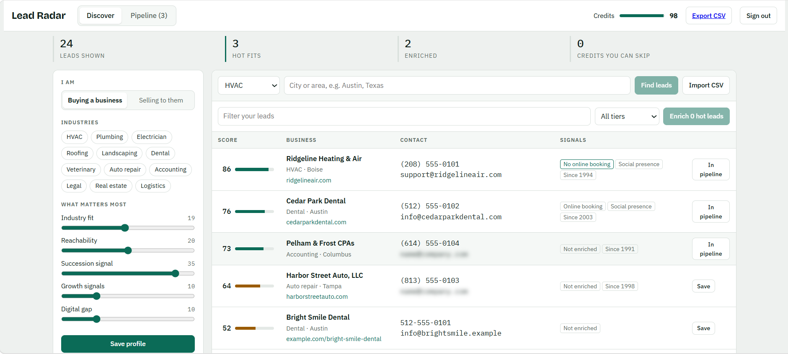
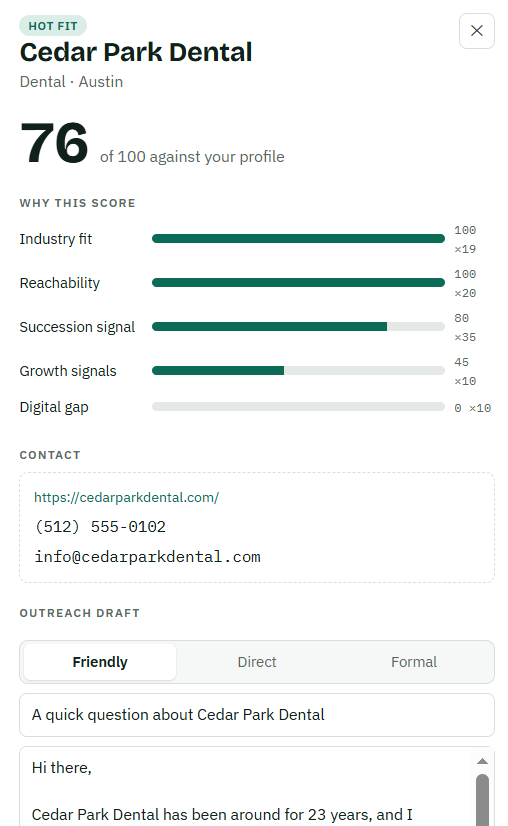
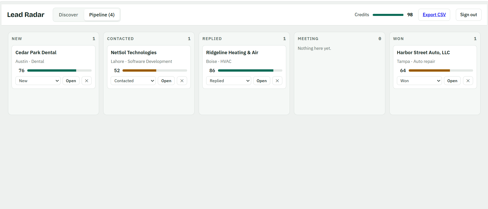

# Lead Radar

Find local businesses, score them against your own ideal customer profile, and spend enrichment credits only on the leads worth it.

## Screenshots


_Search, import a CSV and rank leads against your own profile._


_See exactly why a lead got its score, enrich it and copy a ready-made email._


_Track saved leads from New to Won._

## What is real

- **Discovery:** businesses come from OpenStreetMap (Nominatim for the place, Overpass for the businesses). No API key needed.
- **Enrichment (1 credit):** the server reads the business's own website and extracts emails, phones, founding year ("since 1994"), and signals (hiring, family-owned, online booking, mobile friendly, HTTPS, social links). The credit is charged only if the site was read successfully.
- **Scoring:** five weighted factors (industry fit, reachability, succession, growth, digital gap). The same `lib/scoring.ts` runs in the browser (instant re-ranking) and on the server (stored score, CSV).
- **Pipeline:** save leads, move them through New / Contacted / Replied / Meeting / Won.
- **Outreach:** email draft built from the lead's real signals (buyer or seller mode, three tones).
- **Auth:** email + password (bcrypt), JWT in an httpOnly cookie. Credits are tracked in a ledger table.

## What is not included

OpenStreetMap has no revenue, headcount or owner names, so those are not scored. Adding them needs a paid data provider; plug it into `app/api/leads/[id]/enrich/route.ts`.

## Stack

Next.js 14 (App Router) + TypeScript, PostgreSQL + Prisma, zod validation, cheerio for HTML parsing, jose + bcryptjs for auth, vitest for tests.

## Run locally

```bash
cp .env.example .env          # set JWT_SECRET and CONTACT_EMAIL
docker compose up -d          # PostgreSQL on :5432
npm install
npx prisma migrate dev --name init
npm run dev                   # http://localhost:3000
```

Create an account on the login page, pick an industry, enter a city (for example "Boise, Idaho") and press **Find leads**.

```bash
npm test          # scoring, parsing, SSRF guard, CSV tests
npm run typecheck
npm run build
```

## Deploy

- **Database:** Neon, Supabase or AWS RDS PostgreSQL. Set `DATABASE_URL`, then run `npx prisma migrate deploy`.
- **App:** Vercel, or any Node host (`npm run build && npm start`). Set `DATABASE_URL`, `JWT_SECRET`, `CONTACT_EMAIL`.
- Nominatim and Overpass are free public services with usage limits. For heavy use, self-host them or add Redis caching (the in-memory 6 hour cache in `lib/osm.ts` and the rate limiter in `lib/http.ts` only cover a single instance).

## Security notes

- Website fetching blocks private and internal addresses, re-checks every redirect, and caps size and time (`lib/enrich.ts`).
- CSV export neutralises spreadsheet formulas.
- Login and register are rate limited.
- Scraping a business website for its public contact details is generally allowed, but check local rules (GDPR, CAN-SPAM) before sending cold email.

## Layout

```
app/api/*        auth, me, icp, search, leads, leads/[id], leads/[id]/enrich, export
app/dashboard    main UI      app/login   sign in / register
lib/             osm, enrich, scoring, outreach, auth, db, http, csv
prisma/          schema.prisma (User, Lead, CreditLedger)
tests/           vitest
```
